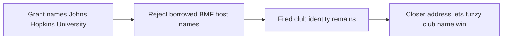

# Comparing the BMF matching policies, 2026-10-28

We are testing the identity policy before another full matcher run. The
October run matched placeholder text and gave university grants to other
EINs whose BMF records carry the university's name. We need to see where
the grants go when we remove those identities, and what legitimate
coverage we would lose.

## What we compare

| policy | recipient text | eligible universe |
|---|---|---|
| `current` | current rules | current universe |
| `placeholders_only` | exclude the gate's placeholder pattern | current universe |
| `no_sort` | exclude placeholders | keep BMF NAME, remove identities supplied only by SORT_NAME |
| `conservative` | exclude placeholders | `no_sort`, also remove a group subordinate's BMF NAME when its cleaned name equals another EIN's filed name |
| `no_bmf` | exclude placeholders | remove all BMF-sourced identities |

A NAME that is also SORT_NAME stays under `no_sort`. A filing-based or
correction identity is never removed by these BMF policies. For the
collision rule we use affiliation `9`, and filed identities from the 990
and 990-PF arms. Sharing a name with another EIN is a reason to test the
policy, not proof that the original match was wrong.

## How we make the comparison repeatable

The code is `givingtuesday_datamart.proofs.bmf_policy_subset`. Unlike the
older historical subset comparison, we compare today's rules against
specific proposed policies on exactly the same frozen inputs.

From the existing matcher box, with its environment active, run:

```bash
python -m givingtuesday_datamart.proofs.bmf_policy_subset extract --out logs/bmf-policy-proof-20261028
python -m givingtuesday_datamart.proofs.bmf_policy_subset compare --out logs/bmf-policy-proof-20261028 --workers 4
```

`extract` uses a read-only, repeatable-read transaction. We create no
database relations and call neither the production builder nor
`write_matches`. Session settings are 64 MB work_mem, zero parallel
workers, a ten-minute timeout per statement, a five-second lock timeout,
and a 4 GB temporary-file cap. Query plans, build metadata, input counts,
and SHA-256 digests are recorded in `inputs.json`. We check database
activity and storage/memory metrics before and during extraction.

We include all recipient tuples matching the diagnostic text patterns
(Hopkins/Jhpiego/Peabody, Duke, Heritage, scouts, fraternal orders, PTA /
parent-teacher names, Doctors Without Borders and River Fund), all tuples
matching the placeholder pattern, and a deterministic 1-in-500 hash
sample of the seven-key recipient tuples. Selection includes unmatched
recipients. Every row of a selected tuple contributes to its counts and
dollars, including older years: eligibility requires at least one 2015+
row, but production's output join attaches the EIN to all years of that
tuple. Diagnostic text patterns do not guarantee every possible fuzzy
spelling of an institution is selected.

Every selected tuple competes against the full universe. We score the
current candidate pairs once with the actual matcher, then remove the
ineligible pairs and resolve each policy, preserving row indices and pair
order. The name-only tier uses the full eligible universe for each
policy. Local score files can resume only when the frozen input manifest
and matcher code hashes agree. We never reuse production checkpoints.

Before interpreting the differences we require today's policy to
reproduce every production winner for the selected tuples, including
tuples unmatched in production. `parity.json` and
`parity_mismatches.csv` record that comparison. A mismatch makes the
command fail; it is not silently counted as a policy effect.

## Reading the outputs

- `summary.csv`: tuples, grant rows, signed dollars and positive dollars
  that keep their EIN, change EIN, lose a match, gain a match, or remain
  unmatched. The general, diagnostic and placeholder cohorts overlap;
  we report them separately and never add their totals. We also report
  the general sample with placeholders excluded, so aggregate placeholder
  amounts do not obscure the cost of changing BMF identity eligibility.
- `changes.csv`: every changed tuple with its address, before/after EIN,
  winning name, source and tier. A changed EIN is not automatically a
  correction. A lost match is not automatically a lost correct match.
- `watched_eins.csv` and `families.csv`: recipient movements in the
  diagnostic groups, including unmatched outcomes in the family report.
- `results.parquet`: all five outcomes for each selected tuple, including
  the baseline and production winner.

Raw snapshots and score files stay under `logs/` on the box. We archive
small reports and reviewed examples with the findings. Dollar totals are
the grants attached to selected recipient tuples, not a scaled estimate
of the whole dataset. The general sample measures policy changes; it is
not a labeled precision benchmark.

The first extraction counted only 2015+ rows. We caught this when the
placeholder total did not reconcile with the gate. We corrected the
default SQL to select eligible tuples with `HAVING bool_or(taxyear >=
2015)` and count all their rows. For the already-scored snapshot,
`recount --out logs/bmf-policy-proof-20261028` reads the all-year weights
in a separate read-only transaction, requires exactly the same recipient
keys in the same order, and regenerates the reports from the stored EIN
decisions. `all_year_weights.json` records that later read and binds its
file hash to the original input manifest. The original snapshot and
scores stay immutable; the count correction does not rescore any pair or
alter an EIN. A fresh `extract` now counts all years directly.

## Validation

The offline fixtures include a university competing with a student host
alias and a group subordinate, a genuine DBA lost by `no_sort`, a
name-only match gained when ambiguity disappears, and a placeholder
matched to a real organization named SEE. For each policy we hold the
filtered-score result to a fresh match of that policy's eligible frames.

```bash
python -m pytest tests/test_bmf_policy_subset.py tests/test_candidate_pairs.py tests/test_chunk_workers.py tests/test_precision_guards.py tests/test_matching_subset.py -q
```

The focused run passed 95 tests (two database tests deselected).
The actual subset run is an additional integration check against
production's winners.

## What the proof found

We scored 47,801,750 candidate pairs against 3,356,738 universe identities.
The subset has 67,037 recipient tuples and 246,282 grant rows after the
all-year correction. Today's policy reproduced production for every
selected tuple: **zero EIN mismatches**, including unmatched tuples.
Scoring, preparation and all five policy resolutions took 613 seconds;
the database extraction and later row recount are separate. The database
had about 63 GB free storage, over 22 GB free memory and roughly 0.002 GB
swap during the observed checks, with no meaningful swap rise.

The general hash sample contains 8,316 tuples and 29,065 rows. After
excluding the 12 placeholder tuples it contains 8,304 tuples, 29,021 rows
and $1.042B of signed grant amounts. Today's policy matches 21,442 of
those rows. The table below is this general non-placeholder sample only,
not the deliberately selected diagnostic families.

| proposed policy | rows becoming unmatched | positive dollars on those rows | rows assigned another EIN | newly matched rows |
|---|---:|---:|---:|---:|
| placeholders only | 0 | $0 | 0 | 0 |
| no SORT_NAME | 432 | $19.82M | 317 | 4 |
| no SORT_NAME + subordinate NAME collision filter | 528 | $20.87M | 539 | 4 |
| no BMF | 4,349 | $102.37M | 805 | 6 |

These are gross movements. We have not labeled every original or new
match, so the unmatched dollars are **not** a measurement of lost correct
coverage, and changed EINs are **not** all improvements. We do not scale
these sample dollars to the population.

All 415 production rows matching the placeholder pattern are in the
subset and become unmatched under every proposed policy. This reconciles
with the full gate's recorded count; the initial 2015-only count was 401.

### The university diagnostic

For this table we use grant tuples whose cleaned recipient name is
exactly `johns hopkins university` or `duke university`. These are not the
total rows attributed to each EIN across every name variant.

| outcome | current | no SORT_NAME | conservative | no BMF |
|---|---:|---:|---:|---:|
| JHU-named rows to university EIN 520595110 | 191 | 288 | 2,824 | 2,824 |
| JHU-named rows to club EIN 520368135 | 0 | 1,163 | 1,163 | 1,163 |
| Duke-named rows to university EIN 560532129 | 1,890 | 5,900 | 5,900 | 5,900 |

A final read-only check of the complete live output counted 209 rows to
the university and 706 to the club across all name variants. The subset
contains all 209 university rows and 701 club rows; five club rows fall
outside its textual diagnostic patterns. The watched-EIN CSV is a
subset report and must not be used as the full-run sentinel count.

The conservative rule directs $1.509B of those JHU-named rows to the
university, but $821.905M still goes to the club. The exact name of the
university loses to the club's fuzzy filed name at a closer address. One
recipient tuple at 3400 North Charles Street alone carries 225 rows and
$643.292M and moves from the ACM chapter to the club. Removing BMF
entirely gives the same residual error, because the club's identity comes
from a filing.



No SORT_NAME alone also leaves JHU's primary-name aliases on Peabody and
Jhpiego: they receive 1,580 and 791 exact-JHU-name rows respectively.
The subordinate collision cut is necessary to remove those particular
aliases, but it does not solve winner resolution after they are gone.

The Duke example improves substantially: the university receives 5,900
exact-name rows / $1.210B instead of 1,890 / $331.755M. Even this is not
perfect: one $4,000 Duke-named row still goes to Drake University and 70
rows remain unmatched.

### What we checked among the losses

The reviewed examples demonstrate both desired refusals and real alias
value:

- Columbia University at 622 West 113th Street: 60 rows / $5.940M were
  assigned to a Psi Chi chapter whose SORT_NAME is the university.
  Leaving these unmatched removes a false attribution.
- Smith College: 11 rows / $433,455 were assigned to a Psi Chi chapter
  whose SORT_NAME is the college. This is the same desired refusal.
- Bates College at 216 Lane Hall, 2 Andrews Road: 16 rows / $250,100 lose
  the college's own EIN. The BMF NAME is `PRESIDENT AND TRUSTEES OF BATES
  COLLEGE`, and its SORT_NAME is the useful common name `BATES COLLEGE`.
- WETA at 3939 Campbell Avenue: six rows / $187,000 lose its own EIN.
  The BMF NAME is `GREATER WASHINGTON EDUCATIONAL TELECOMMUNICATIONS
  ASSOCIATION INC`, and its SORT_NAME is the broadcaster's name `WETA`.
- The largest sampled acronym loss, CHD, carries four rows / $8.054M
  after counting older years. Its BMF alias is on `CENTER FOR HEALTHY
  DEVELOPMENT`, but the grant address is in Geneva and lacks a US state
  or ZIP. We have **not** independently verified the intended recipient;
  we cannot call that amount lost correct coverage merely because the
  acronym is a real BMF alias.

The exact-name Heritage Foundation distribution changes very little
under the two BMF filters. This proof does not validate those remaining
assignments; a common-name collision on another EIN alone is insufficient
to label an attribution wrong.

## Decision supported by this proof

We should keep BMF as an identity source and keep the placeholder
exclusion as a separate, well-defined change. We should **not** run the
full production matcher with the proposed broad policy yet. It both
discards useful own-name aliases and leaves a large known university
misattribution in place.

The next proof should test a narrower rejection of borrowed host/parent
aliases while preserving own-name aliases, and address an exact filed
university name losing to a different EIN's fuzzy club name. A researched
campus-address correction and a more general precision guard are
different possible fixes; neither is implemented by this proof. We can
reuse these frozen recipients and scores for policies that only remove
candidates or change final winner rules. Adding new identity rows needs
new candidate scoring.

We have not changed production relations, matcher thresholds, the input
shape version, gate baselines, or infrastructure classes. This proof
made no paid model calls.

## Archived evidence

- [Policy summary](../data/placeholder_recovery/bmf_policy_subset_summary_2026_10_28.csv)
- [Watched EINs](../data/placeholder_recovery/bmf_policy_subset_watched_eins_2026_10_28.csv)
- [Eight reviewed examples](../data/placeholder_recovery/bmf_policy_subset_reviewed_examples_2026_10_28.csv)

The complete local reports are under `logs/bmf-policy-proof-20261028/`.
The frozen inputs and scores are retained in the refresh logs directory
on the existing box. Both are deliberately excluded from git.
