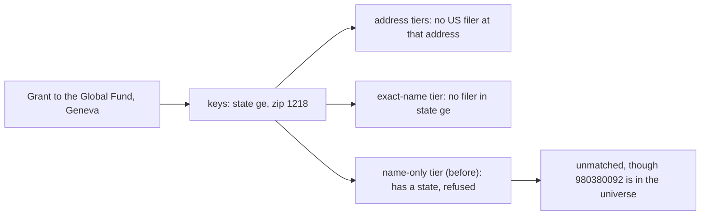

# Foreign recipients on the name-only tier, 2026-10-30

The run of 2026-10-30 matched $2.40B less than the run of 2026-10-28 in
`privategrants_w_recipients`. $0.63B of that is the placeholder rows the
run meant to leave out. The other $1.77B is grants to foreign recipients
whose own EIN is in the filer universe — the Global Fund, the University
of Oxford, AGRA, CIMMYT, the University of Manitoba, CGIAR, the
International Potato Center, the International Vaccine Institute — that
October matched on the name alone and the new run did not. This document
says why, what the fix is, how we chose its signal from the data, and
what a proof on a subset says the next full run will match.

## The mechanism

The name-only tier (`grant_matching.name_only_matches`) takes a grant
tuple that no other tier matched, whose cleaned name belongs to exactly
one filer of the universe. Until this change it took only a tuple with
no state and no zip: a tuple with a state belonged to the exact-name
tier, which matches where the state agrees with the filer's.

GT has always filled a 990-PF grant's US address columns from the
recipient's foreign address when there is no US one: the province goes
in the state column, the postal code in the zip column
([docs/own-extract.md](own-extract.md)). Since concordance
`ce054c032e56` (PR #81) our own extract does the same; its rows of
October left the columns empty. So a grant to the Global Fund in Geneva
now carries `ge` and `1218` in its keys. No address tier can agree a
Swiss canton with a US filer's state, and the name-only tier refused a
tuple with a state. Between the two runs 1,199 names left the matched
output this way, every one matched in October on the name alone to the
recipient's own EIN (593 to a BMF line, 572 to a 990 filing, 33 to a
990-PF, 1 to a correction): 2,595 rows and $1.77B of our 2023-2025 rows.
GT's own rows under the same names, which carry the foreign address,
never matched: 6,862 rows and $3.77B of 2009-2022.



*Figure: how a foreign address kept a recipient off every tier.*

## The rule

A tuple is eligible for the name-only tier when it gives **no US
address** (`grant_matching.no_us_address`):

- its state key is not a US state, the District or a territory, as a
  USPS code or spelled out (`US_STATE_KEYS`): empty, or a province; or
- a row of the tuple names a country other than the US, which the grants
  view now carries as `foreign_country` (`bool_or` over the tuple's rows
  of the country column, `sigocaffrfaco`, not in `US`/`USA`).

The zip key plays no part. The exact-name tier is unchanged: it still
asks for a US state that agrees. The input shape is 8: the grants view
has one more column, the seven keys, the filter and the order are as
before, so row positions do not move.

## Picking the signal from the data

Measured on 2026-10-30 with one scan of `privategrants_current` (the
rows with a business name, grouped by tax year, ingest run, the
country column's value and the shape of the state and zip keys as the
view computes them; read-only, 64 MB `work_mem`, 95 seconds).

**GT's rows (2008-2022, release 2026_06_16).** The country column holds
`USA` on 1,549,219 rows, every one with a US state code in the state key,
a foreign code on 7 rows, and nothing on the rest. So the column cannot
flag a foreign address on GT's rows; the keys must. The state key is a
US code on 10,772,989 rows and a US name on 443; it is empty on 73,680
rows and something else on 52,369 rows ($10.25B). The rows the old rule
could not reach and the new rule can — no US state, and not both keys
empty — are **96,065 rows and $31.6B**:

| GT's rows, state key | zip key empty | zip key five digits | zip key other |
|---|---:|---:|---:|
| empty | 29,984 rows, $6.89B (eligible before) | 19,596 rows, $4.79B | 24,100 rows, $16.61B |
| a province or other text | 18,777 rows, $2.85B | 14,941 rows, $3.07B | 18,651 rows, $4.30B |

The empty-state, five-digit-zip cell is the one a zip test would have
refused, and it is foreign: its cities are Paris (1,046 rows), Jerusalem
(953), Nairobi (827), Beijing (679), New Delhi (450), Berlin (419), Mexico
City, Singapore, Bangkok, Rome; AGRA at Nairobi 00800 alone has $48.7M
(2014), $42.3M (2015), $32.9M (2017) and $30.7M (2012) there. The
empty-state, other-zip cell is London (5,052 rows, $2.48B), Geneva (1,534
rows, $7.48B), Oxford, Cambridge, Brussels. The province cell is Ontario
(2,865 rows as `ontario`, 1,379 as `on`), British Columbia, London,
Israel, Quebec, Jerusalem, `df`, England, Delhi (`dl`), São Paulo.

**Our rows (2019-2025, 38 batches of the IRS's e-file index).** The
country column is set on every foreign row, 47,427 rows and $15.51B
(the XML holds either a US address or a foreign one with its country),
and every domestic row carries a US state code (3,898,690 rows). Of the
foreign rows, 9,052 ($2.80B) have both keys empty and were eligible
already. Of the other 38,375 rows ($12.71B), the state key alone
reaches 37,776 ($12.49B: 21,434 with a province, 16,342 with an empty
state and a postal code), and the country column adds the 599 rows
($0.22B) whose province reads as a US code or name: `tn` for Tamil Nadu
(99 rows), `la` for Lagos (59), `aa` for Addis Ababa (43), `pr` for
Puerto Rico written as a foreign address (25), `wa` for Western
Australia (9). The key rule's only false positives on our rows are 93
domestic rows ($1M) with a five-digit zip and something that is not a
state in the state column.

So: GT's rows need the key rule (their country column says nothing),
our rows are complete under the country column and nearly complete
under the key rule, and the two together reach everything either sees.
A zip test would have cost $4.79B of GT's rows and $2.05B of ours
(the five-digit postal codes of Israel, Germany, France, India, Mexico,
Italy, Kenya, Brazil) for no gain, since no domestic row of either source
has an empty state.

## The proof

`givingtuesday_datamart.proofs.foreign_name_only`, on the pattern of the
October proofs ([rank-policy-subset-2026-10-28.md](rank-policy-subset-2026-10-28.md),
[bmf-policy-subset-2026-10-28.md](bmf-policy-subset-2026-10-28.md)):
frozen inputs, the matcher's own blocking and scoring against the whole
universe, four rules resolved from one scoring, nothing written to
production.

```bash
python -m givingtuesday_datamart.proofs.foreign_name_only extract --out ~/logs/foreign-name-only/proof-20261030
python -m givingtuesday_datamart.proofs.foreign_name_only compare --out ~/logs/foreign-name-only/proof-20261030 --workers 8
```

The tuples, chosen by key alone, every row of each counted:

| cohort | selection |
|---|---|
| `pool` | the 1,199 names of the lost tuples (`data/proofs/name_only_lost_names_2026_10_30.csv`, with October's EIN, arm and matched name) |
| `foreign` | every tuple with no US address that has a state or a zip key, or a row naming another country: what the new rule makes eligible and the old did not |
| `gate` | the gate's named classes, `PFIZER%` and `WORLD HEALTH ORGANI%` |
| `sample` | a 1-in-500 hash sample of every tuple: the control, where nothing but a foreign tuple may move |

The four rules: `before` (no state and no zip), `keys` (the state key
alone), `country` (the old rule plus the country column), `after`
(production's rule, both). The rule before must reproduce the run of
2026-10-30 for every selected tuple, and no rule may lose or move a
match: the tier only adds.

RESULTS_PLACEHOLDER
