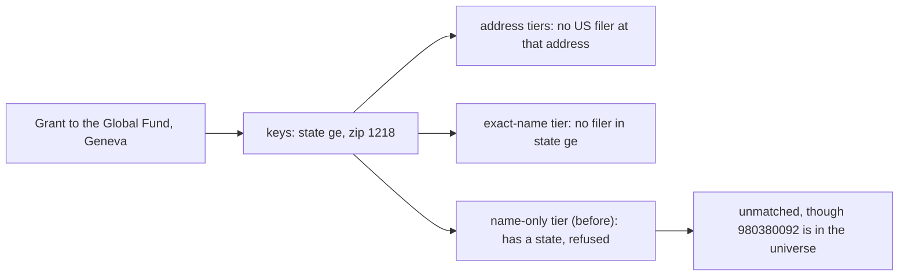

# Foreign recipients on the name-only tier, 2026-10-30

The run of 2026-10-30 matched $2.40B less than the run of 2026-10-28 in
`privategrants_w_recipients`. $0.63B of that is the placeholder rows the
run meant to leave out. The other $1.77B is grants to foreign recipients
whose own EIN is in the filer universe — the Global Fund, the University
of Oxford, AGRA, CIMMYT, the University of Manitoba, CGIAR, the
International Potato Center, the International Vaccine Institute — that
October matched on the name alone and the new run did not. This document
says why, what the fix is, how we chose its signal from the data, and
what a proof on a subset says the next full run will match.

## The mechanism

The name-only tier (`grant_matching.name_only_matches`) takes a grant
tuple that no other tier matched, whose cleaned name belongs to exactly
one filer of the universe. Until this change it took only a tuple with
no state and no zip: a tuple with a state belonged to the exact-name
tier, which matches where the state agrees with the filer's.

GT has always filled a 990-PF grant's US address columns from the
recipient's foreign address when there is no US one: the province goes
in the state column, the postal code in the zip column
([docs/own-extract.md](own-extract.md)). Since concordance
`ce054c032e56` (PR #81) our own extract does the same; its rows of
October left the columns empty. So a grant to the Global Fund in Geneva
now carries `ge` and `1218` in its keys. No address tier can agree a
Swiss canton with a US filer's state, and the name-only tier refused a
tuple with a state. Between the two runs 1,199 names left the matched
output this way, every one matched in October on the name alone to the
recipient's own EIN (593 to a BMF line, 572 to a 990 filing, 33 to a
990-PF, 1 to a correction): 2,595 rows and $1.77B of our 2023-2025 rows.
GT's own rows under the same names, which carry the foreign address,
never matched: 6,862 rows and $3.77B of 2009-2022.



*Figure: how a foreign address kept a recipient off every tier.*

## The rule

A tuple is eligible for the name-only tier when it gives **no US
address** (`grant_matching.no_us_address`):

- its state key is not a US state, the District or a territory, as a
  USPS code or spelled out (`US_STATE_KEYS`): empty, or a province; or
- a row of the tuple names a country other than the US, which the grants
  view now carries as `foreign_country` (`bool_or` over the tuple's rows
  of the country column, `sigocaffrfaco`, not in `US`/`USA`).

The zip key plays no part. The exact-name tier is unchanged: it still
asks for a US state that agrees. The input shape is 8: the grants view
has one more column, the seven keys, the filter and the order are as
before, so row positions do not move.

## Picking the signal from the data

Measured on 2026-10-30 with one scan of `privategrants_current` (the
rows with a business name, grouped by tax year, ingest run, the
country column's value and the shape of the state and zip keys as the
view computes them; read-only, 64 MB `work_mem`, 95 seconds).

**GT's rows (2008-2022, release 2026_06_16).** The country column holds
`USA` on 1,549,219 rows, every one with a US state code in the state key,
a foreign code on 7 rows, and nothing on the rest. So the column cannot
flag a foreign address on GT's rows; the keys must. The state key is a
US code on 10,772,989 rows and a US name on 443; it is empty on 73,680
rows and something else on 52,369 rows ($10.25B). The rows the old rule
could not reach and the new rule can — no US state, and not both keys
empty — are **96,065 rows and $31.6B**:

| GT's rows, state key | zip key empty | zip key five digits | zip key other |
|---|---:|---:|---:|
| empty | 29,984 rows, $6.89B (eligible before) | 19,596 rows, $4.79B | 24,100 rows, $16.61B |
| a province or other text | 18,777 rows, $2.85B | 14,941 rows, $3.07B | 18,651 rows, $4.30B |

The empty-state, five-digit-zip cell is the one a zip test would have
refused, and it is foreign: its cities are Paris (1,046 rows), Jerusalem
(953), Nairobi (827), Beijing (679), New Delhi (450), Berlin (419), Mexico
City, Singapore, Bangkok, Rome; AGRA at Nairobi 00800 alone has $48.7M
(2014), $42.3M (2015), $32.9M (2017) and $30.7M (2012) there. The
empty-state, other-zip cell is London (5,052 rows, $2.48B), Geneva (1,534
rows, $7.48B), Oxford, Cambridge, Brussels. The province cell is Ontario
(2,865 rows as `ontario`, 1,379 as `on`), British Columbia, London,
Israel, Quebec, Jerusalem, `df`, England, Delhi (`dl`), São Paulo.

**Our rows (2019-2025, 38 batches of the IRS's e-file index).** The
country column is set on every foreign row, 47,427 rows and $15.51B
(the XML holds either a US address or a foreign one with its country),
and every domestic row carries a US state code (3,898,690 rows). Of the
foreign rows, 9,052 ($2.80B) have both keys empty and were eligible
already. Of the other 38,375 rows ($12.71B), the state key alone
reaches 37,776 ($12.49B: 21,434 with a province, 16,342 with an empty
state and a postal code), and the country column adds the 599 rows
($0.22B) whose province reads as a US code or name: `tn` for Tamil Nadu
(99 rows), `la` for Lagos (59), `aa` for Addis Ababa (43), `pr` for
Puerto Rico written as a foreign address (25), `wa` for Western
Australia (9). The key rule's only false positives on our rows are 93
domestic rows ($1M) with a five-digit zip and something that is not a
state in the state column.

So: GT's rows need the key rule (their country column says nothing),
our rows are complete under the country column and nearly complete
under the key rule, and the two together reach everything either sees.
A zip test would have cost $4.79B of GT's rows and $2.05B of ours
(the five-digit postal codes of Israel, Germany, France, India, Mexico,
Italy, Kenya, Brazil) for no gain, since no domestic row of either source
has an empty state.

## The proof

`givingtuesday_datamart.proofs.foreign_name_only`, on the pattern of the
October proofs ([rank-policy-subset-2026-10-28.md](rank-policy-subset-2026-10-28.md),
[bmf-policy-subset-2026-10-28.md](bmf-policy-subset-2026-10-28.md)):
frozen inputs, the matcher's own blocking and scoring against the whole
universe, four rules resolved from one scoring, nothing written to
production.

```bash
python -m givingtuesday_datamart.proofs.foreign_name_only extract --out ~/logs/foreign-name-only/proof-20261030
python -m givingtuesday_datamart.proofs.foreign_name_only compare --out ~/logs/foreign-name-only/proof-20261030 --workers 8
```

The tuples, chosen by key alone, every row of each counted:

| cohort | selection |
|---|---|
| `pool` | the 1,199 names of the lost tuples (`data/proofs/name_only_lost_names_2026_10_30.csv`, with October's EIN, arm and matched name) |
| `foreign` | every tuple with no US address that has a state or a zip key, or a row naming another country: what the new rule makes eligible and the old did not |
| `gate` | the gate's named classes, `PFIZER%` and `WORLD HEALTH ORGANI%` |
| `sample` | a 1-in-500 hash sample of every tuple: the control, where nothing but a foreign tuple may move |

The four rules: `before` (no state and no zip), `keys` (the state key
alone), `country` (the old rule plus the country column), `after`
(production's rule, both). The rule before must reproduce the run of
2026-10-30 for every selected tuple, and no rule may lose or move a
match: the tier only adds.

## What the proof found

The extract ran 2026-10-30 18:01 to 18:11 UTC in one read-only
repeatable-read transaction (589 seconds): 3,356,738 universe identities,
the 2,594,841 matched tuples of the run of 2026-10-30, and 84,723 grant
tuples (142,273 tuple-year rows). The cohorts overlap: 7,381 tuples under
the pool's names, 65,904 foreign, 104 of the gate's names, 8,330 in the
sample. The comparison scored 43,434,369 candidate pairs in 384 seconds
on the box, with no database access.

**Parity.** The rule before reproduces the run of 2026-10-30 for all
84,723 tuples, matched and unmatched: zero mismatches. No rule loses or
moves a match; every change is a tuple gained on the name-only tier.

**What the rule adds.** 4,099 grant tuples, 9,543 grant rows and $8.570B
(positive amounts $8.571B), to 1,761 recipients. Every gain is in the
foreign cohort. In the control sample 8 tuples gain, all foreign, and
nothing else moves there. No recovered grant gains: a recovered row has no
country and its state comes from a US address or nothing.

| tax year | tuples | rows | of them our extract's | dollars | under the pool's names |
|---|---:|---:|---:|---:|---:|
| 2009-2014 | 340 | 453 | 0 | $1.267B | $0.114B |
| 2015 | 383 | 457 | 0 | $0.465B | $0.075B |
| 2016 | 361 | 450 | 0 | $0.467B | $0.079B |
| 2017 | 390 | 503 | 0 | $0.496B | $0.091B |
| 2018 | 449 | 648 | 0 | $0.930B | $0.497B |
| 2019 | 559 | 776 | 0 | $0.923B | $0.562B |
| 2020 | 788 | 1,110 | 0 | $0.701B | $0.665B |
| 2021 | 825 | 1,161 | 19 | $0.748B | $0.683B |
| 2022 | 874 | 1,215 | 151 | $0.771B | $0.719B |
| 2023 | 900 | 1,304 | 1,304 | $0.835B | $0.800B |
| 2024 | 874 | 1,281 | 1,281 | $0.906B | $0.875B |
| 2025 | 176 | 185 | 185 | $0.062B | $0.059B |
| **all** | **4,099** | **9,543** | **2,940** | **$8.570B** | **$5.218B** |

*The tuples column counts a tuple in each year it has rows; the last line counts it once.*

So $1.802B is our extract's (2023-2025) and $6.768B is GT's release
(2009-2022, with 170 rows of ours in 2021-2022).

**The $1.77B back.** Our 2023-2025 rows under the pool's names that the
run of 2026-10-30 left unmatched are 2,903 rows and $1.761B. The rule
matches 2,391 of them, $1.733B. The other 512 rows ($28M) carry a US
address under the same names (Food for Education and the United Nations
in New York, the Global Fund's Washington office), which the rule leaves
to the address tiers as before. (The step 9 correction gave 2,595 rows
and $1.77B for the same names under another filter; the dollars agree.)

**GT's rows.** Under the pool's names GT's release has 6,862 rows and
$3.767B that never matched. The rule matches 4,167 of them, $3.448B. Of
the rest, 1,280 rows ($0.258B) are tuples with no row of 2015 or later,
which the matcher's view leaves out, and 1,415 rows ($0.061B) carry a US
state key with no country, which on GT's rows cannot be told from a US
address. Beyond the pool, the rule matches 2,844 rows and $3.352B more,
mostly GT's.

**What each signal does.**

| rule | tuples gained | rows | dollars | of which this signal alone |
|---|---:|---:|---:|---:|
| the state key alone | 4,077 | 9,510 | $8.556B | 2,512 tuples, $5.050B (GT's rows) |
| the country column alone | 1,587 | 4,648 | $3.520B | 22 tuples, $13.6M (provinces that read as US codes) |
| both (production) | 4,099 | 9,543 | $8.570B | |

## Who the matches go to

The task's question: is the filer the recipient's own foreign
registration, a 98- EIN, or a domestic EIN? A domestic EIN turned out to
be two different things, by where the filer's own row is.

| the filer | tuples | recipients | rows | of them ours | dollars |
|---|---:|---:|---:|---:|---:|
| a 98- EIN, the recipient's foreign registration | 1,159 | 161 | 3,516 | 1,088 | $6.769B |
| a domestic EIN filing from abroad: the recipient itself, registered in the US | 527 | 114 | 1,342 | 388 | $0.767B |
| a domestic EIN at a US address: a US arm, a friends organization or a namesake | 2,413 | 1,486 | 4,685 | 1,464 | $1.035B |

The filer's row is the universe row the match won with. The second line
is the CGIAR centers and other international bodies that file a 990 from
abroad under a US EIN: the International Vaccine Institute (311621592,
$126M), CIMMYT (237181761, $109M), IITA (237185633, $104M), the
International Potato Center (237396123, $85M), IRRI (237185638, $74M),
ILRI (521953157, $44M), McMaster University and other Canadian
universities' US EINs.

The recipients gaining the most:

| EIN | recipient (the name it matched) | filer | rows gained | dollars | rows on 2026-10-30 | rows expected |
|---|---|---|---:|---:|---:|---:|
| 980593375 | gavi alliance | 98- | 26 | $2.872B | 33 | 59 |
| 980380092 | global fund to fight aids tuberculosis and malaria | 98- | 48 | $1.893B | 8 | 56 |
| 986008078 | university of manitoba | 98- | 142 | $0.279B | 0 | 142 |
| 980513530 | alliance for a green revolution in africa | 98- | 42 | $0.274B | 9 | 51 |
| 986001062 | chancellor masters and scholars of the university of oxford | 98- | 312 | $0.248B | 10 | 322 |
| 311621592 | international vaccine institute | domestic, abroad | 112 | $0.126B | 0 | 112 |
| 986000867 | rhodes trust | 98- | 26 | $0.109B | 0 | 26 |
| 237181761 | centro internacional de mejoramiento de maiz y trigo | domestic, abroad | 33 | $0.109B | 0 | 33 |
| 237185633 | international institute of tropical agriculture | domestic, abroad | 51 | $0.104B | 1 | 52 |
| 981135729 | cgiar system organization | 98- | 39 | $0.095B | 0 | 39 |
| 237396123 | international potato center | domestic, abroad | 29 | $0.085B | 2 | 31 |
| 237185638 | international rice research institute | domestic, abroad | 26 | $0.074B | 0 | 26 |
| 980459537 | african agricultural technology foundation | 98- | 35 | $0.074B | 0 | 35 |
| 986001255 | university of british columbia | 98- | 271 | $0.065B | 10 | 281 |
| 131599108 | chancellor masters and scholars of the university of cambridge | domestic, US address | 79 | $0.064B | 5 | 84 |

The full list of the 60 largest is archived with the proof.

### The question for Zein: domestic EINs at a US address

The third class is $1.035B, 4,685 rows. The twenty largest, read by name
and address only (not verified against filings):

| EIN | matched name | filer's city | grants addressed to | rows | dollars | reading |
|---|---|---|---|---:|---:|---|
| 131599108 | university of cambridge (a BMF line) | New York | Cambridge | 79 | $63.9M | US friends organization |
| 311685031 | sahaj marg spirituality foundation | Austin, TX | Chennai | 13 | $60.8M | US organization of the same name |
| 131867411 | amref health africa | New York | Nairobi, Addis Ababa | 51 | $59.4M | US arm |
| 530204670 | hospital for sick children | Washington, DC | Toronto | 72 | $49.7M | another organization: the DC hospital, not SickKids |
| 061608361 | african population and health research center | Rockville, MD | Nairobi | 59 | $47.3M | US arm |
| 133902012 | university of the witwatersrand | New York | Johannesburg | 168 | $44.2M | US friends organization |
| 843629323 | girl effect | New York | London | 22 | $41.7M | US arm |
| 463611387 | speak up africa | New York | Dakar | 27 | $39.6M | US arm |
| 300245250 | deutsche stiftung weltbevoelkerung | New York | Hannover, Nairobi | 48 | $38.9M | US arm |
| 237187762 | centro internacional de agricultura tropical | Medley, FL | Cali, Palmira | 31 | $34.3M | the recipient itself, US-registered |
| 810739440 | american online giving foundation | Newark, DE | Calgary | 3 | $33.5M | the recipient named (Benevity's US fund, run from Calgary) |
| 521726273 | american academy in berlin | New York | Berlin | 28 | $28.7M | the recipient itself, US-registered |
| 270278612 | world health partners | Rio Vista, CA | New Delhi | 9 | $23.4M | unclear |
| 136024454 | oxford university (a BMF line) | Wilmington, DE | Oxford | 22 | $16.0M | unclear; not the university's 98- EIN |
| 042730954 | fauna and flora international | Chevy Chase, MD | Cambridge | 48 | $13.7M | US arm |
| 271269519 | international trade union confederation | Washington, DC | Brussels | 16 | $12.5M | US office |
| 952248462 | project concern international | San Diego, CA | New Delhi | 17 | $11.5M | the recipient itself |
| 832074441 | brac | Crete, NE | Dhaka | 10 | $11.1M | another organization of the same one-word name |
| 135596846 | american university of beirut | New York | Beirut | 49 | $10.5M | the recipient itself, US-chartered |
| 521923660 | confederation of indian industry | Arlington, VA | New Delhi | 12 | $10.1M | US office |

Most are the recipient's US arm or friends organization, or the recipient
itself; a few are another organization with the same name (the DC
Hospital for Sick Children for SickKids in Toronto; for one-word names,
a Nebraska filer named BRAC for grants to Dhaka, one in South Carolina
named FAU for Erlangen, one in Nebraska named CNRS for Paris). The one-word names are 246 tuples, 400 rows and $44M of the
class. October's run matched our rows this way too: of the 1,199 tuples
the run of 2026-10-30 lost, 1,041 had gone to a domestic EIN.

The choices, with what each keeps:

| choice | keeps | drops |
|---|---:|---:|
| accept domestic EINs, as built and as October did | $8.570B | nothing |
| refuse a foreign tuple's name-only match to a filer at a US address | $7.535B | 2,413 tuples, 4,685 rows, $1.035B |
| refuse only one-word names to a filer at a US address | $8.526B | 246 tuples, 400 rows, $0.044B |

Whichever is chosen, the namesakes that carry money (the DC Hospital for
Sick Children) want a corrections row for the right recipient. I built the
rule as the task asked and as October behaved; the choice is Zein's.

## The gate

The gate's recipient sentinels get the Global Fund (980380092): 8 rows on
2026-10-30, 56 expected on the next run (10 tuples, 48 rows, $1.893B
gained), a floor of 53. It fails against the output of 2026-10-30 until
the run, by design, and the commit that accepts the run sets it from the
run's count ([runbook](matching-regression-runbook.md)). No other check
moves: the gate's named classes (`PFIZER%`, `WORLD HEALTH ORGANI%`, 104
tuples) match the same EINs under all four rules (no filer owns the WHO's
cleaned name alone, so its Geneva tuples stay unmatched); of the other
sentinels' EINs only the Michael J. Fox Foundation gains, one row of
$104; a name-only match scores as an exact name, so the government-name
guard sees nothing new; and the labeled-pair coverage can only rise. The
proof does not measure the self-match count, a WARN.

## What the next full run should expect

On the inputs of 2026-10-30 (a run on newer inputs moves with them):

- The name-only tier: 40,394 grant tuples, 44,493 after (+4,099).
- `privategrants_w_recipients`: 10,925,841 rows, 10,935,384 after (+9,543),
  and +$8.570B, by tax year as in the table above. `unioned_grants` gains
  the same rows less any its `UNION` folds as identical.
- The arms: `basic_fields` +6,151 rows, `eo_bmf` +3,233, `basic_fields_pf`
  +158, `correction` +1.
- The gate: the Global Fund at 56 (floor 53); everything else as on
  2026-10-30.

## Archived evidence

- [Summary by rule, cohort and change](../data/placeholder_recovery/foreign_name_only_summary_2026_10_30.csv)
- [Gains by tax year](../data/placeholder_recovery/foreign_name_only_by_year_2026_10_30.csv)
- [Gains by kind of filer and arm](../data/placeholder_recovery/foreign_name_only_by_kind_2026_10_30.csv)
- [The 60 recipients gaining most](../data/placeholder_recovery/foreign_name_only_recipients_2026_10_30.csv)
- [The 60 largest gains to a domestic EIN](../data/placeholder_recovery/foreign_name_only_examples_2026_10_30.csv)
- [What each signal adds](../data/placeholder_recovery/foreign_name_only_signals_2026_10_30.csv)

The frozen inputs, the score cache and `results.parquet` stay in the
proof's directory on the box, out of git. Nothing was written to the
shared database; the extract's plans and file digests are in its
`inputs.json`.
